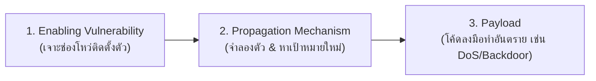
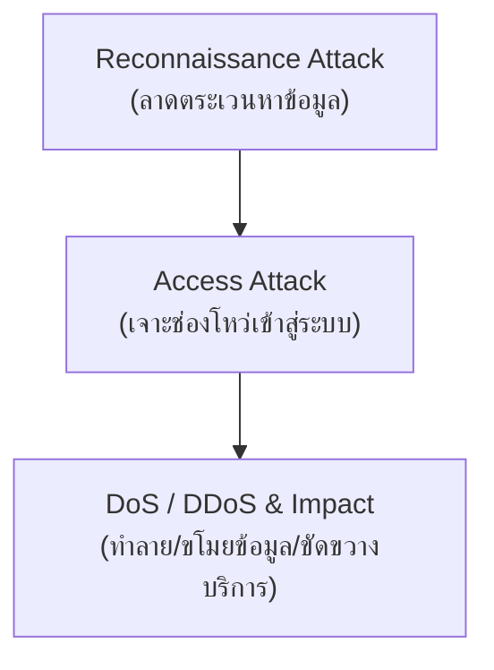
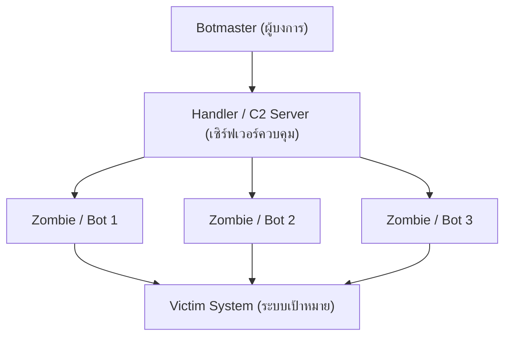

# บทที่ 6: ภัยคุกคามและการโจมตีทั่วไป (Common Threats & Attacks)

> **วิชา:** Cyber Security & CyberOps Associate  
> **เอกสารอ้างอิง:** [06-CommonThreats.pdf](file:///d:/3term1/cyber%20security/slides/06-CommonThreats.pdf) (39 หน้า)  
> **เป้าหมาย:** ทำความเข้าใจประเภทของมัลแวร์ ลำดับขั้นตอนการโจมตีเครือข่าย (Reconnaissance, Access, DoS/DDoS) วิศวกรรมสังคม และเทคนิคการหลบหลีก (Evasion Techniques)

---

## 1. การจำแนกประเภทมัลแวร์ (Malware Classification)

**Malware (Malicious Software)** คือซอฟต์แวร์หรือโค้ดที่ออกแบบมาเพื่อสร้างความเสียหาย ขัดขวาง ขโมย หรือกระทำการที่ไม่ได้รับอนุญาตต่อข้อมูล โฮสต์ หรือเครือข่าย

### 1.1 สามมัลแวร์หลักที่ต้องแยกให้ออก (Core Malware)
| มัลแวร์ | กลไกการทำงาน | การแพร่พันธุ์ | จุดสังเกตในข้อสอบ |
| :--- | :--- | :--- | :--- |
| **Virus** | แทรกตัวเองลงในโปรแกรมอื่น (Host program) | **ต้องอาศัยการกระทำของผู้ใช้** (เช่น กดเปิดไฟล์ .exe, เสียบ USB) | ไม่สามารถแพร่พันธุ์เองได้ถ้าไม่มีคนเรียกใช้โปรแกรมโฮสต์ |
| **Worm** | เป็นโปรแกรมอิสระ (**Self-contained**) | **แพร่กระจายข้ามเครือข่ายได้เองอัตโนมัติ** ผ่านช่องโหว่ | แพร่เร็วมาก ทำเครือข่ายอืดชะงัก ไม่ต้องอาศัยผู้ใช้ |
| **Trojan Horse** | พรางตัวเป็นโปรแกรมที่มีประโยชน์หรือน่าเชื่อถือ | หลอกล่อให้ผู้ใช้ติดตั้งด้วยตนเอง | เปิดช่องทางลับ (Backdoor), ขโมยรหัสผ่าน, ไม่จำลองตัวเอง |

### 1.2 สามส่วนประกอบของหนอนคอมพิวเตอร์ (Worm Components)

* **Enabling vulnerability:** กลไกเจาะช่องโหว่ของระบบ (Exploit mechanism) เพื่อติดตั้งตัว เช่น ผ่าน email attachment หรือ network exploit
* **Propagation mechanism:** หลังเข้าเครื่องได้ จะจำลองตัวเองและสแกนค้นหาเครื่องเหยื่อรายใหม่บนเครือข่าย
* **Payload:** โค้ดที่กระทำการอันตราย เช่น เปิด Backdoor หรือสั่งยิง DoS

> [!NOTE]
> **กรณีศึกษาสำคัญในสไลด์:**
> * **Code Red Worm (2001):** เริ่มต้นติดเซิร์ฟเวอร์ 658 เครื่อง ผ่านไปเพียง 19 ชั่วโมง ติดเชื้อกว่า 300,000 เซิร์ฟเวอร์ทั่วโลก
> * **SQL Slammer Worm:** โจมตีช่องโหว่ Buffer Overflow ใน Microsoft SQL Server เครื่องติดเชื้อเพิ่มขึ้นเท่าตัวทุกๆ **8.5 วินาที** โดยสาเหตุเกิดจากเซิร์ฟเวอร์ขาดการลงแพตช์ที่ปล่อยออกมาก่อนหน้านั้นถึง **6 เดือน**!

---

## 2. ลำดับขั้นตอนการโจมตีเครือข่าย (Network Attack Lifecycle)

### 2.1 ลำดับ 5 ขั้นของการทำ Reconnaissance
1. **Information query:** หาข้อมูลเบื้องต้นจาก Whois, Google, เว็บไซต์องค์กร เพื่อหาช่วง IP
2. **Ping sweep:** ส่ง ICMP ตรวจสอบว่า IP ใดในเครือข่ายมีเครื่องเปิดอยู่จริง (Active IP addresses)
3. **Port scan:** ใช้ Nmap หรือ SuperScan ตรวจสอบพอร์ตและบริการที่เปิด (Open Ports/Services)
4. **Vulnerability scan:** ใช้ Nessus, OpenVAS สแกนหาจุดอ่อนและบั๊กของบริการที่เปิด
5. **Exploitation:** ใช้ Metasploit, Core Impact รันโค้ดเจาะระบบ

### 2.2 การโจมตีเพื่อเข้าถึง (Access Attacks)
* **Password Attacks:** Brute-force, Dictionary attacks
* **Trust Exploitation:** เจาะเครื่อง A ที่ได้รับความเชื่อถือจากเครื่อง B แล้วใช้เครื่อง A เป็นสะพานทะลุเข้าเครื่อง B
* **Port Redirection:** ส่งต่อทราฟฟิก (เช่น ผ่าน SSH พอร์ต 22) ไปยังพอร์ต 23 (Telnet) ของเครื่องภายใน
* **Buffer Overflow:** ส่งข้อมูลล้นพื้นที่หน่วยความจำที่จองไว้ เช่น *Ping of Death* (ส่ง IP packet ขนาดเกิน 65,535 bytes ทำให้เครื่องรับแครช)

---

## 3. วิศวกรรมสังคม (Social Engineering): โจมตีจุดอ่อนมนุษย์

| เทคนิค | พฤติกรรมและการลงมือ |
| :--- | :--- |
| **Pretexting** | กุเรื่องราวหรือสร้างสถานการณ์สมมุติขึ้นมาเพื่อหลอกถามข้อมูลส่วนบุคคล/การเงิน |
| **Phishing / Spear Phishing** | ส่งอีเมลหลอกลวง (Spear Phishing จะเจาะจงเป้าหมายเฉพาะบุคคลหรือองค์กรโดยเฉพาะ) |
| **Baiting** | วางแฟลชไดรฟ์ติดมัลแวร์ทิ้งไว้ในที่สาธารณะล่อให้เหยื่อนำไปเสียบใช้งาน |
| **Tailgating (Piggybacking)** | เดินตามหลังผู้มีสิทธิ์เข้าประตูพื้นที่หวงห้ามอย่างกระชั้นชิด |
| **Shoulder Surfing** | แอบชะโงกดูหน้าจอหรือการกดรหัสผ่านเหนือไหล่ของเหยื่อ |
| **Dumpster Diving** | คุ้ยถังขยะเพื่อค้นหาเอกสารสำคัญหรือรหัสผ่านที่ทิ้งแล้ว |
| **SET (Social Engineer Toolkit)** | ชุดเครื่องมือทดสอบเจาะระบบด้าน Social Engineering สำหรับฝ่ายป้องกัน |

---

## 4. องค์ประกอบ DDoS และเทคนิคการหลบหลีก (Evasion Methods)

### เทคนิคการหลบหลีก (Evasion Techniques)
* **Traffic Fragmentation:** ซอยย่อยเพย์โหลดเป็นแพ็กเก็ตเล็กๆ เพื่อให้หลุดรอดจาก Signature ของ IPS
* **Traffic Substitution / Insertion:** เข้ารหัสแบบอื่น (เช่น Unicode) หรือแทรกไบต์ขยะหลอก IPS
* **Protocol-level Misinterpretation:** อาศัยข้อผิดพลาดในการคำนวณ TTL หรือ Checksum หลอกไฟร์วอลล์
* **Pivoting:** ใช้เครื่องที่เจาะได้แล้วเป็นฐานเพื่อเจาะเครื่องอื่นต่อในเครือข่ายภายใน
* **Rootkits:** ฝังตัวในระดับ OS เพื่อปกปิดไฟล์ โปรเซส และการเชื่อมต่อ
