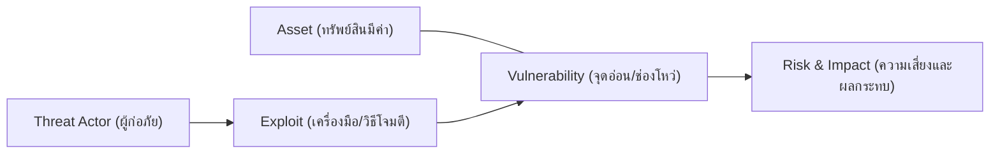

# บทที่ 7: ผู้โจมตีและเครื่องมือ (Attackers and Their Tools)

> **วิชา:** Cyber Security & CyberOps Associate  
> **เอกสารอ้างอิง:** [07-Attacker&tools.pdf](file:///d:/3term1/cyber%20security/slides/07-Attacker&tools.pdf) (30 หน้า)  
> **เป้าหมาย:** เข้าใจความสัมพันธ์ของ Asset, Threat, Vulnerability, Exploit, Risk; 4 วิธีการจัดการความเสี่ยง; การจำแนกประเภท Threat Actors; เครื่องมือความปลอดภัย และการวิเคราะห์ IOC vs IOA

---

## 1. กรอบแนวคิดความปลอดภัย: Asset, Threat, Vulnerability, Exploit, Risk

* **Asset:** สิ่งที่มีค่าและต้องปกป้อง เช่น ฐานข้อมูลลูกค้า ทรัพย์สินทางปัญญา
* **Vulnerability:** ข้อบกพร่องหรือจุดอ่อนในระบบ เช่น บั๊กที่ยังไม่ลงแพตช์ รหัสผ่านอ่อนแอ
* **Threat / Threat Actor:** ภัย หรือบุคคล/กลุ่มคนที่เป็นแหล่งอันตราย
* **Attack Surface:** พื้นผิวหรือช่องทางทั้งหมดที่เข้าถึงและใช้โจมตีได้
* **Exploit:** กลไกหรือโค้ดที่ใช้ช่องโหว่เพื่อสร้างผลกระทบ
* **Risk:** โอกาสเกิดร่วมกับขนาดความเสียหาย ($Risk = Likelihood \times Impact$)

---

## 2. การบริหารจัดการความเสี่ยง 4 รูปแบบ (4 Risk Responses)

| รูปแบบ | นิยาม | ตัวอย่างจริง |
| :--- | :--- | :--- |
| **Avoidance (การหลีกเลี่ยง)** | ยุติหรือยกเลิกกิจกรรมที่เป็นต้นเหตุของความเสี่ยง | เลิกเปิดบริการเก่าที่ไม่จำเป็น ตัดการเชื่อมต่อพอร์ตเสี่ยง |
| **Reduction / Mitigation (การลด)** | ใช้มาตรการควบคุมเพื่อลดโอกาสหรือผลกระทบ | ติดตั้งแพตช์, ใช้ MFA, ติดตั้งไฟร์วอลล์, สำรองข้อมูล |
| **Transfer / Sharing (การโอน/แบ่งปัน)** | โอนหรือแบ่งปันภาระความเสียหายไปยังบุคคลที่สาม | ซื้อประกันภัยไซเบอร์ (Cyber Insurance), จ้าง MSP ดูแล |
| **Acceptance / Retention (การยอมรับ)** | รับรู้และยอมรับความเสี่ยงคงเหลือ (Residual Risk) | ระบบทดสอบที่ไม่สำคัญ ต้นทุนป้องกันแพงกว่าความเสียหาย |

---

## 3. ประเภทผู้โจมตีและแรงจูงใจ (Threat Actors)

* **White Hat:** ผู้เชี่ยวชาญที่มีจริยธรรม ทดสอบอย่างได้รับอนุญาตตามสัญญา (Ethical Hacker)
* **Black Hat:** แฮกเกอร์หมวกดำ บุกรุกโดยไม่ได้รับอนุญาตเพื่อหาผลประโยชน์หรือทำลายระบบ
* **Gray Hat:** แอบทดสอบโดยไม่ได้รับอนุญาต แม้ไม่ได้มุ่งทำลายหรือหวังผลกำไร (รวม Vulnerability Brokers ตามสไลด์)
* **Script Kiddie:** ขาดทักษะเชิงลึก ใช้สคริปต์หรือเครื่องมือสำเร็จรูปโดยไม่เข้าใจผลกระทบ
* **Hacktivist:** มีแรงจูงใจทางการเมือง สังคม หรืออุดมการณ์เพื่อเรียกร้องความสนใจ
* **Cybercriminal:** มุ่งเน้นผลประโยชน์ทางการเงินเป็นหลัก (เช่น Ransomware, ขโมยข้อมูลบัตร)
* **State-Sponsored:** ได้รับการสนับสนุนจากรัฐบาล มุ่งจารกรรมยุทธศาสตร์ มีทุนและทักษะสูงมาก

---

## 4. ตัวบ่งชี้ภัยคุกคาม: IOC vs IOA

| มิติ | Indicator of Compromise (IOC) | Indicator of Attack (IOA) |
| :--- | :--- | :--- |
| **คำนิยาม** | ร่องรอย/วัตถุพยานที่ชี้ว่า **ถูกบุกรุกไปแล้ว** | รูปแบบพฤติกรรมหรือกลยุทธ์ **ในขณะเกิดเหตุ** |
| **สิ่งที่ใช้ตรวจ** | ค่า Hash มัลแวร์, หมายเลข IP อันตราย, ชื่อโดเมน C2 | การล็อกอินผิดพลาดซ้ำๆ, การยกระดับสิทธิ์, พฤติกรรม Anomaly |
| **มุมมองการตรวจ** | Signature-based (ตรวจเทียบสิ่งที่รู้จัก) | Behavior-based (ตรวจจับพฤติกรรมน่าสงสัย) |

---

## 5. หมวดหมู่เครื่องมือความปลอดภัย (Security Tools Matrix)

* **Password Crackers:** John the Ripper, Ophcrack, L0phtCrack
* **Wireless Tools:** Aircrack-ng, Kismet
* **Port Scanners:** Nmap, SuperScan
* **Packet Crafters:** Hping, Scapy
* **Packet Sniffers:** Wireshark, tcpdump, TShark
* **Rootkit Detectors:** AIDE (Advanced Intrusion Detection Environment)
* **Fuzzers:** Skipfish, Wapiti
* **Digital Forensics:** The Sleuth Kit, Helix, Autopsy
* **Exploitation Frameworks:** Metasploit, Core Impact
