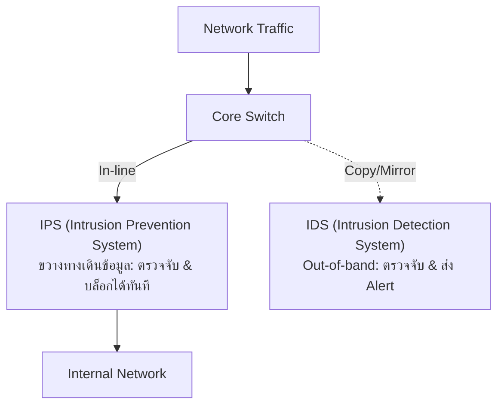
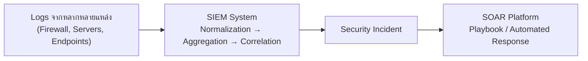

# บทที่ 8: การตรวจสอบเครือข่ายและเครื่องมือ (Network Monitoring & Tools)

> **วิชา:** Cyber Security & CyberOps Associate  
> **เอกสารอ้างอิง:** [08-Net_Monitor.pdf](file:///d:/3term1/cyber%20security/slides/08-Net_Monitor.pdf) (23 หน้า)  
> **เป้าหมาย:** เข้าใจสถาปัตยกรรมเฝ้าระวังเครือข่าย (IDS vs IPS), การดึงทราฟฟิก (TAP vs SPAN/RSPAN), Full Packet Capture vs NetFlow, และการทำงานของ SIEM & SOAR ร่วมกับ ELK Stack

---

## 1. สถาปัตยกรรมเฝ้าระวังเครือข่าย: IDS vs IPS

* **IDS (Intrusion Detection System):** ติดตั้งแบบ Out-of-band รับสำเนาทราฟฟิก ตรวจจับและส่ง Alert แจ้งเตือน ไม่กระทบความเร็วเครือข่าย (Latency)
* **IPS (Intrusion Prevention System):** ติดตั้งแบบ In-line ขวางทางเดินข้อมูลจริง ตรวจจับและสามารถสั่งบล็อก ดรอป หรือรีเซ็ตการเชื่อมต่ออันตรายได้ทันที

---

## 2. วิธีการดึงสำเนาข้อมูล: Network TAP vs Switch SPAN

| มิติเปรียบเทียบ | Network TAP (Test Access Point) | Switch SPAN (Port Mirroring) |
| :--- | :--- | :--- |
| **ลักษณะ** | อุปกรณ์ฮาร์ดแวร์ต่อคั่นสายสัญญาณจริง | ฟังก์ชันซอฟต์แวร์คัดลอกพอร์ตบนสวิตช์ |
| **ความสมบูรณ์** | ส่งสำเนา 100% ไม่ดรอปแพ็กเก็ตแม้ทราฟฟิกแน่น | อาจดรอปแพ็กเก็ตสำเนาหากสวิตช์ทำงานหนัก |
| **ภาระต่อสวิตช์** | ไม่กิน CPU และหน่วยความจำของสวิตช์ | ใช้ CPU และแบนด์วิดท์ภายในของสวิตช์ |
| **ค่าใช้จ่าย** | ต้องซื้ออุปกรณ์ TAP เพิ่มเติม | ใช้ความสามารถที่มีอยู่แล้วบนสวิตช์ |

* **Ingress / Egress:** ทราฟฟิกขาเข้า / ขาออกจากอุปกรณ์สวิตช์
* **SPAN Source / Destination:** พอร์ตต้นทางที่เฝ้าดู / พอร์ตปลายทางที่ต่อเข้าเครื่องวิเคราะห์
* **RSPAN (Remote SPAN):** ใช้ VLAN พิเศษส่งสำเนาทราฟฟิกข้ามสวิตช์ไปยังเครื่องวิเคราะห์ระยะไกล

---

## 3. Wireshark (Full Packet Capture) vs NetFlow

* **Full Packet Capture (เช่น Wireshark, tcpdump):** บันทึกทุกไบต์ของแพ็กเก็ต รวมถึง Header และ Payload ละเอียดสูงสุดแต่กินพื้นที่มหาศาล
* **NetFlow (Cisco):** บันทึกเฉพาะสรุปสถิติ Metadata ของโฟลว์ (Source/Dest IP, Port, Protocol, Bytes, Time) เหมาะกับการวิเคราะห์ภาพรวมและดูพฤติกรรมผิดปกติ ประหยัดพื้นที่จัดเก็บ

---

## 4. ศูนย์รวมข้อมูลความปลอดภัย: SIEM และ SOAR

### 5 ฟังก์ชันหลักของระบบ SIEM
1. **Normalization:** แปลงรูปแบบ Log ต่างฟอร์แมตให้เป็นโครงสร้างมาตรฐานเดียวกัน
2. **Aggregation:** รวมรายการเหตุการณ์ซ้ำซ้อนเพื่อลดขนาดพื้นที่
3. **Correlation:** เชื่อมโยงเหตุการณ์ต่างแหล่งเข้าด้วยกันเพื่อสร้าง Incident เดียว
4. **Forensic Analysis:** ค้นหาและตรวจสอบพยานหลักฐานย้อนหลังเพื่อสืบสวน
5. **Reporting & Compliance:** สร้างรายงานตามข้อกำหนดมาตรฐาน

### ชุดเครื่องมือยอดนิยม
* **ELK Stack:** **Elasticsearch** (ค้นหาและจัดเก็บดัชนี), **Logstash** (Data pipeline แปลงข้อมูล), **Kibana** (Dashboard กราฟิกบนเว็บ)
* **Security Onion:** Linux distro สำเร็จรูปสำหรับงาน Network Security Monitoring รวม Snort, Suricata, Zeek, ELK ไว้ในชุดเดียว
