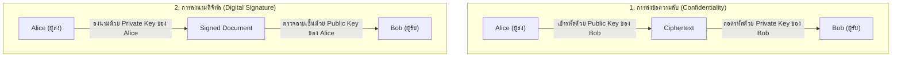

# บทที่ 9: การเข้ารหัสและความปลอดภัยเครือข่าย (Cryptography)

> **วิชา:** Cyber Security & CyberOps Associate  
> **เอกสารอ้างอิง:** [09-Cryptography-net.pdf](file:///d:/3term1/cyber%20security/slides/09-Cryptography-net.pdf) (70 หน้า)  
> **เป้าหมาย:** เข้าใจเป้าหมาย CIA Triad, ฟังก์ชัน Hash, HMAC, Symmetric vs Asymmetric Ciphers, หลักการใช้คู่กุญแจ, Digital Signatures, Diffie-Hellman และระบบ PKI

---

## 1. เสาหลักความมั่นคงปลอดภัยและเป้าหมาย

| เป้าหมาย | คำถามหลัก | กลไกทางรหัสลับ |
| :--- | :--- | :--- |
| **Confidentiality (การรักษาความลับ)** | คนไม่มีสิทธิ์แอบเปิดอ่านได้ไหม? | Encryption (Symmetric & Asymmetric) |
| **Integrity (ความถูกต้องสมบูรณ์)** | ข้อมูลถูกแอบแก้ไข ดัดแปลงไหม? | Hash Functions, HMAC, Digital Signatures |
| **Authentication (การยืนยันตัวตน)** | ผู้ส่งหรือแหล่งที่มาเป็นตัวจริงไหม? | HMAC (กลุ่มแชร์คีย์), Digital Signatures, PKI |
| **Non-repudiation (ปฏิเสธไม่ได้)** | มีหลักฐานผูกมัดผู้ส่งไหม? | Digital Signatures (ลงนามด้วย Private Key ผู้ส่ง) |

---

## 2. ฟังก์ชัน Hash vs HMAC

* **Hash Function:** ฟังก์ชันคณิตศาสตร์ทางเดียว (One-way) แปลงข้อมูลใดๆ เป็น Digest ความยาวคงที่เสมอ ย้อนกลับไม่ได้ (MD5: 128 บิต, SHA-1: 160 บิต, SHA-256: 256 บิต) ให้เฉพาะ **Integrity**
* **HMAC (Hash-based Message Authentication Code):** คำนวณ Hash ร่วมกับ **Secret Key ที่แชร์ร่วมกัน** ให้ทั้ง **Integrity + Origin Authentication** แต่ *ไม่มี Non-repudiation* เพราะทั้งสองฝ่ายถือกุญแจลับอันเดียวกัน

---

## 3. Symmetric vs Asymmetric Encryption

| คุณสมบัติ | Symmetric (กุญแจสมมาตร) | Asymmetric (กุญแจอสมมาตร) |
| :--- | :--- | :--- |
| **กุญแจ** | กุญแจลับเดียวกัน (Shared Secret Key) | คู่กุญแจ: Public Key + Private Key |
| **ความเร็ว** | เร็วมาก เหมาะกับข้อมูลขนาดใหญ่ | ช้า กินทรัพยากรสูงกว่า |
| **การแจกจ่ายคีย์** | ยุ่งยาก ต้องมีช่องทางปลอดภัยในการแชร์คีย์ | สะดวก แจกจ่าย Public Key ได้อย่างเปิดเผย |
| **อัลกอริทึม** | **AES** (Block 128 บิต, Key 128/192/256), DES, 3DES, RC4 | **RSA**, Diffie-Hellman (DH), DSA, ECDSA |

> [!IMPORTANT]
> **ขนาดของ AES ตามมาตรฐาน NIST FIPS 197:**
> * **Block size คงที่ที่ 128 บิต (16 ไบต์) เสมอ**
> * Key size สามารถเลือกได้: 128, 192, หรือ 256 บิต

---

## 4. หลักการใช้คู่กุญแจในการส่งข้อความลับ vs การลงนามดิจิทัล

### สรุปหลักการจำในห้องสอบ
1. **ต้องการส่งข้อความลับให้ B:** Alice ใช้ **Public Key ของ B** เข้ารหัส $\rightarrow$ Bob ใช้ **Private Key ของ B** ถอดรหัส (ถามว่า “ใครควรเปิดอ่านได้? $\rightarrow$ Bob”)
2. **Alice ต้องการลงนามเอกสารส่งให้ B:** Alice ใช้ **Private Key ของ Alice** ลงนาม $\rightarrow$ Bob ใช้ **Public Key ของ Alice** ตรวจสอบลายเซ็น (ถามว่า “ใครเป็นคนส่ง? $\rightarrow$ Alice”)

---

## 5. PKI และใบรับรองดิจิทัล (Digital Certificates)

* **X.509 v3:** มาตรฐานโครงสร้างใบรับรองดิจิทัลที่ผูกตัวตนเข้ากับ Public Key
* **CA (Certificate Authority):** องค์กรที่ได้รับความไว้วางใจในการออกและลงนามรับรองใบรับรอง
* **Diffie-Hellman (DH):** โปรโตคอลตกลงกุญแจลับร่วมกัน (Shared Secret) ผ่านช่องทางที่ไม่ปลอดภัย ไม่ได้ใช้เข้ารหัสข้อความโดยตรง
* **การเพิกถอนใบรับรอง:** ตรวจสอบผ่าน **CRL** (Certificate Revocation List) หรือสอบถามออนไลน์ผ่าน **OCSP** (Online Certificate Status Protocol)
