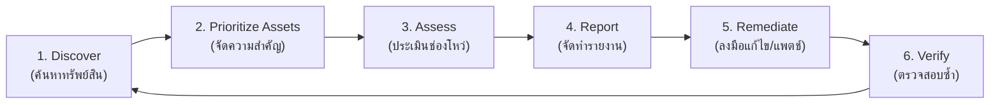

# บทที่ 10: การประเมินช่องโหว่เครื่องปลายทาง (Endpoint Vulnerability Assessment)

> **วิชา:** Cyber Security & CyberOps Associate  
> **เอกสารอ้างอิง:** [10-Vulnerability-Asses.pdf](file:///d:/3term1/cyber%20security/slides/10-Vulnerability-Asses.pdf) (36 หน้า)  
> **เป้าหมาย:** เข้าใจการทำ Profiling และ Baseline; ระบบให้คะแนน CVSS v3.1; ความต่าง CVE/CVSS/NVD; วงจรจัดการช่องโหว่ 6 ขั้นตอน และการจัดการแพตช์ร่วมกับ ISMS

---

## 1. การจัดทำโปรไฟล์และค่ามาตรฐานอ้างอิง (Baseline & Profiling)

* **Baseline:** ภาพจำลองสภาพการทำงานปกติของระบบและเครือข่าย เพื่อใช้เป็นจุดอ้างอิงในการตรวจจับความผิดปกติ (Anomaly)
* **Network Profiling:** ตรวจสอบ Session duration, Throughput, พอร์ตบริการที่ใช้งาน, รายการ IP สำคัญ
* **Server Profiling:** ตรวจสอบ Listening ports, บัญชีผู้ใช้, Service accounts, ซอฟต์แวร์และเวอร์ชันที่ติดตั้ง
* **Vulnerability Assessment vs Pen Testing:**
  * *Vulnerability Assessment:* มุ่งค้นหาและจัดทำรายการช่องโหว่ทั้งหมดในระบบ (Nessus, OpenVAS)
  * *Penetration Testing:* มุ่งจำลองการโจมตีจริงเพื่อพิสูจน์ผลกระทบว่าเจาะได้ลึกเพียงใด (Metasploit)

---

## 2. ระบบคะแนนความรุนแรงของช่องโหว่: CVSS v3.1

### 2.1 CVE vs CVSS vs NVD
* **CVE:** รหัสอ้างอิงสากลของช่องโหว่ (Common Vulnerabilities and Exposures)
* **CVSS:** ระบบและสูตรคำนวณคะแนนความรุนแรงเชิงเทคนิค (0.0 ถึง 10.0)
* **NVD:** ฐานข้อมูลช่องโหว่แห่งชาติของสหรัฐฯ เก็บรายละเอียด CVE, CVSS, และวิธีแก้ไข

### 2.2 ระดับความรุนแรงตามช่วงคะแนน CVSS v3.1
| ช่วงคะแนน | ระดับความรุนแรง (Severity) | ตัวอย่างการจัดการ |
| :--- | :--- | :--- |
| **0.0** | None | ไม่มีความเสี่ยง |
| **0.1 – 3.9** | Low | ความรุนแรงต่ำ เฝ้าระวังหรือแพตช์ตามรอบปกติ |
| **4.0 – 6.9** | Medium | ความรุนแรงปานกลาง วางแผนแพตช์ในรอบบำรุงรักษา |
| **7.0 – 8.9** | High | ความรุนแรงสูง ต้องเร่งดำเนินการแก้ไข |
| **9.0 – 10.0** | **Critical** | ความรุนแรงวิกฤต (เช่น 9.8) ต้องแก้ไขหรือตัดการเชื่อมต่อทันที |

### 2.3 สามกลุ่มตัวชี้วัดของ CVSS (Metric Groups)
1. **Base Metric Group:** คุณสมบัติประจำตัวช่องโหว่ที่ไม่เปลี่ยนตามเวลา (AV, AC, PR, UI, Scope, CIA Impact)
2. **Temporal Metric Group:** ปัจจัยที่เปลี่ยนตามกาลเวลา (สถานะโค้ด Exploit, สถานะการมีแพตช์)
3. **Environmental Metric Group:** บริบทเฉพาะขององค์กรและความสำคัญของระบบต่อธุรกิจ

---

## 3. วงจรการบริหารจัดการช่องโหว่ 6 ขั้นตอน (Vulnerability Lifecycle)

> [!IMPORTANT]
> **ขั้นตอนที่ 6 (Verify):** หลังติดตั้งแพตช์เสร็จ ต้องทำการสแกนตรวจสอบยืนยันซ้ำเสมอว่าช่องโหว่ถูกปิดเรียบร้อยและไม่กระทบการทำงานของระบบ

---

## 4. เทคนิคการจัดการแพตช์และการควบคุมการตั้งค่า

* **Agent-based:** มี Agent ติดตั้งบนเครื่องลูกข่าย เหมาะกับอุปกรณ์พกพาที่อยู่นอกออฟฟิศ
* **Agentless:** สแกนและสั่งติดตั้งจากเซิร์ฟเวอร์ส่วนกลางผ่านเครือข่าย เหมาะกับเซิร์ฟเวอร์ภายใน
* **Passive Monitoring:** ตรวจจับเวอร์ชันซอฟต์แวร์จากแพ็กเก็ตทราฟฟิกในเครือข่าย
* **Configuration Management Tools:** Puppet, Chef, Ansible, SaltStack ควบคุมการตั้งค่าอัตโนมัติ
* **ISMS (ISO/IEC 27001):** ระบบบริหารความมั่นคงปลอดภัยสารสนเทศ ยึดวงจร **PDCA (Plan-Do-Check-Act)**
