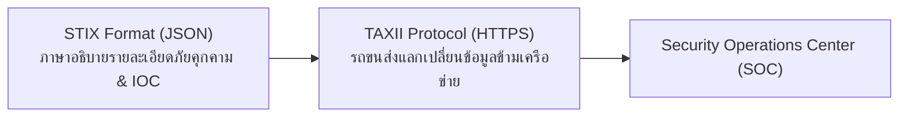

# บทที่ 11: ข้อมูลความปลอดภัยและข่าวกรองภัย (Security Data & Threat Intelligence)

> **วิชา:** Cyber Security & CyberOps Associate  
> **เอกสารอ้างอิง:** [11-SecurityData.pdf](file:///d:/3term1/cyber%20security/slides/11-SecurityData.pdf) (58 หน้า)  
> **เป้าหมาย:** ทำความเข้าใจประเภทของข้อมูลความปลอดภัย (Alert, Session, Transaction, PCAP); องค์ประกอบ 5-Tuple; การคำนวณและถอดรหัส Syslog PRI; และระบบ Threat Intelligence (STIX, TAXII, TTPs, Talos)

---

## 1. ประเภทข้อมูลความปลอดภัยและองค์ประกอบ 5-Tuple

| ประเภทข้อมูล | สิ่งที่ระบุ | ตัวอย่างในสไลด์ |
| :--- | :--- | :--- |
| **Alert Data** | แจ้งเตือนเมื่อพบเหตุการณ์ตรงตามกฎหรือ Signature | Snort Alert, IPS Drop Notification |
| **Session Data** | สรุปการสนทนาของโฟลว์ (ใครคุยกับใคร เมื่อไร ปริมาณเท่าไร) | NetFlow, IPFIX |
| **Transaction Data** | คำขอและคำตอบที่มีการแลกเปลี่ยนจริงในเซสชัน | HTTP Request/Response, DNS Query/Reply |
| **Full Packet Capture** | ข้อมูลแพ็กเก็ตดิบทุกไบต์รวมถึง Payload ทั้งหมด | PCAP (Wireshark, tcpdump) |
| **Statistical Data** | ข้อมูลสถิติภาพรวมและการเบี่ยงเบนจากค่าปกติ | MRTG, ทราฟฟิกเฉลี่ยรายสัปดาห์ |

### องค์ประกอบของ 5-Tuple
$$5\text{-Tuple} = \text{Source IP} + \text{Destination IP} + \text{Source Port} + \text{Destination Port} + \text{Protocol}$$
*(จำว่าไม่ใช่หมายเลข IP จำนวน 5 หมายเลข)*

---

## 2. ระบบ Syslog และสูตรการคำนวณค่า PRI

ระดับความรุนแรงใน Syslog: **ตัวเลขยิ่งน้อย ยิ่งมีความร้ายแรงสูง**

| ค่า Severity | ชื่อระดับ (Severity Level) | ความหมาย |
| :---: | :--- | :--- |
| **0** | **Emergency** | ระบบใช้งานไม่ได้เลย (ร้ายแรงสูงสุด) |
| **1** | **Alert** | ต้องดำเนินการแก้ไขทันที |
| **2** | **Critical** | ภาวะวิกฤต |
| **3** | **Error** | เกิดข้อผิดพลาด |
| **4** | **Warning** | คำเตือน |
| **5** | **Notice** | เหตุการณ์ปกติแต่ควรสังเกต |
| **6** | **Informational** | ข้อมูลการทำงานปกติทั่วไป |
| **7** | **Debug** | ข้อมูลสำหรับดีบักแก้ปัญหา (ร้ายแรงน้อยสุด) |

### สูตรคำนวณค่า PRI
$$\mathbf{PRI = (Facility \times 8) + Severity}$$

#### ตัวอย่างการคำนวณในข้อสอบ:
1. **คำนวณไปข้างหน้า:** Facility = 4 (auth), Severity = 3 (Error)  
   $$PRI = (4 \times 8) + 3 = 32 + 3 = \mathbf{35}$$
2. **คำนวณย้อนกลับ:** ได้รับค่า PRI = 82 จงหา Facility และ Severity  
   นำ $82 \div 8 = \mathbf{10} \text{ เศษ } \mathbf{2}$  
   $\rightarrow$ Facility = 10 (authpriv), Severity = 2 (Critical)
3. **ตัวอย่างย้อนกลับ:** ได้รับค่า PRI = 165  
   นำ $165 \div 8 = \mathbf{20} \text{ เศษ } \mathbf{5}$  
   $\rightarrow$ Facility = 20 (local4), Severity = 5 (Notice)

---

## 3. ข่าวกรองภัยคุกคาม (Threat Intelligence) และมาตรฐานการแลกเปลี่ยน

* **STIX (Structured Threat Information Expression):** ภาษาและโครงสร้างข้อมูลมาตรฐาน (JSON) สำหรับอธิบายข้อมูลภัยคุกคาม IOC และ TTPs
* **TAXII (Trusted Automated eXchange of Intelligence Information):** โปรโตคอลขนส่งข้อมูล STIX ผ่าน HTTPS/REST APIs
* **CybOX:** ภาษาอธิบายสิ่งที่สังเกตได้ในระบบ (Observable เช่น Registry, Hash, Packets)
* **TTPs:** Tactics, Techniques, and Procedures (กลยุทธ์ เทคนิค และขั้นตอนการทำงานของคนร้าย)
* **Cisco Talos:** ศูนย์วิจัยข่าวกรองความปลอดภัยระดับโลกของ Cisco ที่สร้างกฎสำหรับ Snort และ ClamAV
* **Honeypot:** ระบบล่อที่จงใจเปิดไว้เพื่อดักจับและศึกษาพฤติกรรมการโจมตี
