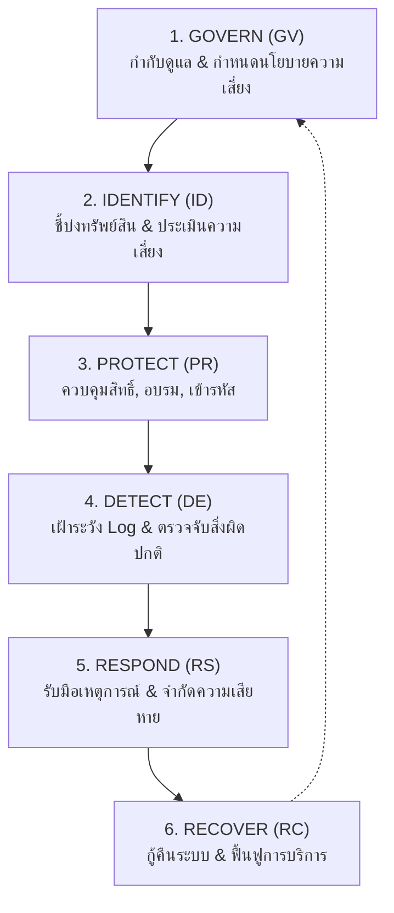

# บทที่ 12: กรอบงานความมั่นคงปลอดภัยและมาตรฐาน (Cybersecurity Frameworks)

> **วิชา:** Cyber Security & CyberOps Associate  
> **เอกสารอ้างอิง:** [12-SecurityFramework.pdf](file:///d:/3term1/cyber%20security/slides/12-SecurityFramework.pdf) (42 หน้า)  
> **เป้าหมาย:** เข้าใจประเภทกรอบงานไซเบอร์ (Risk, Program, Control); NIST CSF 2.0 ครบทั้ง 6 ฟังก์ชัน; NIST Tiers 1-4; ISO 27001 vs 27002; CIS Controls v7.1; COBIT 5; PCI DSS และ HIPAA/HITRUST

---

## 1. การจำแนกประเภทกรอบงานความมั่นคงปลอดภัยไซเบอร์

| ประเภทกรอบงาน | วัตถุประสงค์หลัก | ตัวอย่างในสไลด์ |
| :--- | :--- | :--- |
| **Risk Frameworks** | มุ่งเน้นการประเมินและการบริหารจัดการความเสี่ยง | NIST SP 800-30, ISO/IEC 27005 |
| **Program Frameworks** | มุ่งเน้นการสร้างและบริหารโครงสร้างโครงการความปลอดภัยภาพรวม | NIST CSF, ISO/IEC 27001 |
| **Control Frameworks** | กำหนดรายการมาตรการควบคุมเชิงเทคนิคและข้อปฏิบัติอย่างละเอียด | NIST SP 800-53, CIS Controls, PCI DSS |

---

## 2. NIST Cybersecurity Framework 2.0 (NIST CSF 2.0)

ในเวอร์ชัน **NIST CSF 2.0** มีทั้งหมด **6 ฟังก์ชันหลัก** โดยเพิ่มฟังก์ชัน **Govern** เข้ามาครอบคลุมภาพรวมทั้งหมด:

### NIST CSF Implementation Tiers (ระดับวุฒิภาวะ 4 ระดับ)
* **Tier 1: Partial (ทำเป็นบางส่วน):** ขาดนโยบายทางการ จัดการความเสี่ยงแบบเฉพาะหน้า
* **Tier 2: Risk-Informed (ตระหนักถึงความเสี่ยง):** ตระหนักถึงความเสี่ยงแต่ยังไม่มีนโยบายครอบคลุมทั่วทั้งองค์กร
* **Tier 3: Repeatable (มีกระบวนการสม่ำเสมอ):** มีนโยบายทางการและปฏิบัติอย่างสม่ำเสมอทั่วทั้งองค์กร
* **Tier 4: Adaptive (ปรับตัวตามภัยคุกคาม):** ระดับสูงสุด มีการปรับเปลี่ยนมาตรการเชิงรุกตามภัยได้อย่างยืดหยุ่น

---

## 3. มาตรฐานสากลและการปฏิบัติตามข้อกำหนด (Compliance)

| มาตรฐาน / กรอบงาน | จุดเน้นและคีย์เวิร์ดในข้อสอบ |
| :--- | :--- |
| **ISO/IEC 27001** | ข้อกำหนดระบบบริหารจัดการความมั่นคงปลอดภัยสารสนเทศ (**ISMS Requirements**) ใช้สำหรับตรวจประเมินเพื่อขอใบรับรอง (**Certification**) |
| **ISO/IEC 27002** | คู่มือแนวทางรายละเอียดการนำมาตรการควบคุมความปลอดภัย (**Controls**) ไปปฏิบัติ |
| **CIS Controls v7.1** | มาตรการควบคุม **20 Controls** แบ่งเป็น Basic (1–6), Foundational (7–16), และ Organizational (17–20) |
| **COBIT 5** | กรอบธรรมาภิบาลและการบริหาร IT โดยมีหลักการเด่นคือ **Separating Governance from Management** |
| **PCI DSS** | ปกป้องข้อมูลผู้ถือบัตรชำระเงิน (**Cardholder Data**) มี **12 Requirements** ใน 6 เป้าหมาย |
| **HIPAA** | กฎหมายคุ้มครองข้อมูลสุขภาพของสหรัฐฯ ประกอบด้วย **Privacy Rule** (ความเป็นส่วนตัว PHI) และ **Security Rule** (คุ้มครอง ePHI) |
| **HITRUST CSF** | กรอบงานและระบบการประเมินรับรองที่พัฒนาขึ้นสำหรับอุตสาหกรรมสุขภาพ (**Healthcare**) โดยเฉพาะ |
